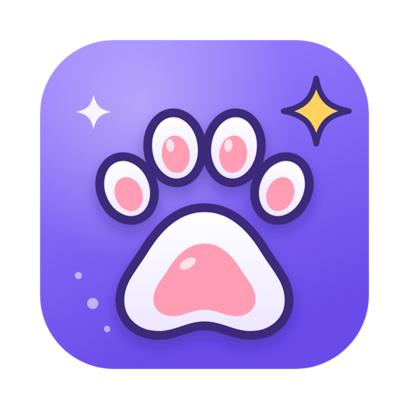

# Dusty design language

Dusty should feel like a friendly pet that tidies up, not a system utility. The cat is playful, the cleaning is
precise and the copy is honest about what gets deleted.

<p align="center">
  
  &nbsp;&nbsp;
  
  &nbsp;&nbsp;
  
</p>

## Principles

1. **The cleaning is the hero.** Every screen answers *how much*, *what* and *is it safe*. Dusty adds warmth, not noise.
2. **Safe by default, loud about the rest.** Safe picks are preselected. Anything that costs a re-download is off and
   marked *opt-in*. Destructive actions always get a confirm step.
3. **One color per kind of mess.** A group keeps the same color everywhere: app rows, website cards, the disk bar.
4. **Chunky and tactile.** Buttons have a solid bottom edge and press down. The app adds haptics on Force Touch trackpads.

## Color

App (light, `app/src/ui.rs`):

| Token | Hex | Use |
|---|---|---|
| `BG` | `#FFFBF5` | window background, warm paper |
| `INK` | `#2B2340` | text |
| `MUTED` | `#8A84A3` | secondary text |
| `LINE` | `#E8E4F3` | card borders, button edges on light |
| `CARD` | `#FFFFFF` | cards and speech bubbles |

Tones, each with `base / edge / soft`:

| Tone | Base | Edge | Soft | Group |
|---|---|---|---|---|
| Grape | `#7C5CFF` | `#5B3FD9` | `#EFEAFF` | brand, primary action, re-downloadable |
| Coral | `#FF5A6E` | `#D63D52` | `#FFE5E9` | build folders, destructive confirm |
| Sun | `#FFC83D` | `#E0A100` | `#FFF4D6` | dev caches |
| Sky | `#3DB8FF` | `#1E93D6` | `#E3F5FF` | app caches |
| Teal | `#2EC4B6` | `#1E9C90` | `#DDF7F4` | junk and logs |
| Blue | `#5B8DEF` | `#3F6FD1` | `#E6EEFF` | Docker |
| Mint | `#22C993` | `#169E72` | `#DFF8EE` | success, space freed |

The website (`site/`) is the night version: plum background `#17112B`, surfaces `#251C44`, lines `#3A2F63`, and the
same tones. App screenshots stay light, so they read like windows glowing in the dark.

## Type

- **Display:** system rounded (`ui-rounded`, SF Pro Rounded) at weight 900. Headlines, big numbers like *66.2 GB*,
  button labels in uppercase.
- **Body:** system UI at 400–600.
- **Code and paths:** system monospace.

No web fonts. The app uses `.SystemUIFont` with `FontWeight::BLACK` for display.

## Dusty

- Source art is `app/assets/dusty-sheet.png`: a lavender cat with a mint bandana and a fluffy cream tail, in front,
  three-quarter and back views plus five expressions (idle, happy, sad, surprised, sleepy).
- In the app the sheet is cut into a rig and animated live (`app/src/dusty/`). Moods follow the task: *think* while
  scanning, *wow* at a big find, *hungry* before cleaning, a chomp per item, *happy* when done, *sad* when an item
  can't be cleaned or the disk is nearly full.
- Dusty speaks in short bubbles, first person, lowercase energy: "Feeling a bit… heavy today.", "Om nom nom.",
  "Checking with git so I never touch your real code." Jokes never hide facts: sizes and paths are always exact.

## App icon

`assets/brand/dusty-icon.svg` is the master. A cream paw with pink toe beans on a grape squircle, a sun-colored
sparkle (clean!) and a few dust specks being swept off the corner. It follows the macOS grid: an 824 px squircle on a
1024 px canvas.

Regenerate `app/assets/Dusty.icns` after editing the SVG:

```bash
"/Applications/Google Chrome.app/Contents/MacOS/Google Chrome" --headless=new --default-background-color=00000000 \
  --window-size=1024,1024 --screenshot=/tmp/icon.png assets/brand/dusty-icon.svg
mkdir -p /tmp/Dusty.iconset
for s in 16 32 128 256 512; do
  sips -z $s $s /tmp/icon.png --out /tmp/Dusty.iconset/icon_${s}x${s}.png
  sips -z $((s*2)) $((s*2)) /tmp/icon.png --out /tmp/Dusty.iconset/icon_${s}x${s}@2x.png
done
iconutil -c icns /tmp/Dusty.iconset -o app/assets/Dusty.icns
```

## Motion

- Springs over easing curves. Things pop, hop and settle.
- The splash is under a second (badge pop, dust sweep, iris onto Dusty) and a click skips it.
- Dusty runs at 60 fps while moving, 30 while breathing and 12 when the window isn't focused.
- On the web, dust drifts slowly and the disk bar fills in once. Both stop under `prefers-reduced-motion`.

## Voice

| Do | Don't |
|---|---|
| "Nothing is deleted until you say so." | "Optimize your system!" |
| "Slack is open, so its cache was left alone." | "Some items could not be processed." |
| "Re-downloadable: off until you tick it." | "Advanced cleaning" |
