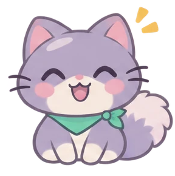
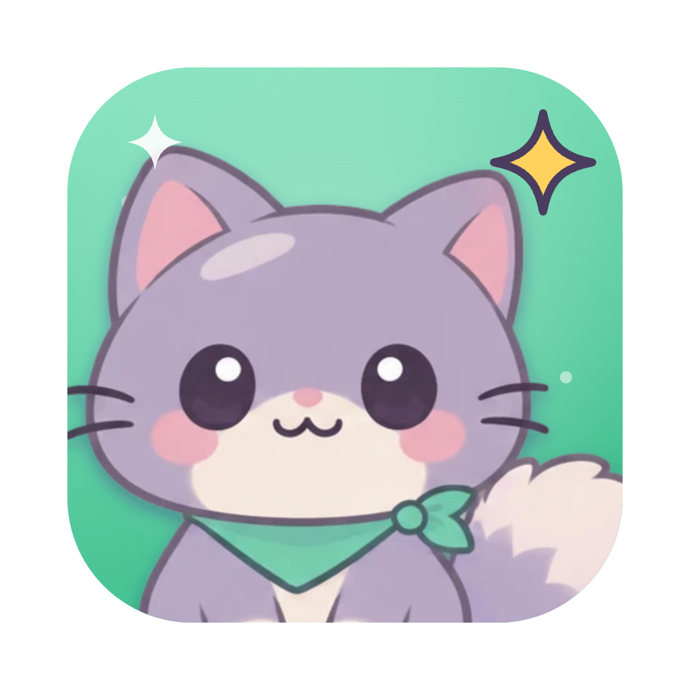
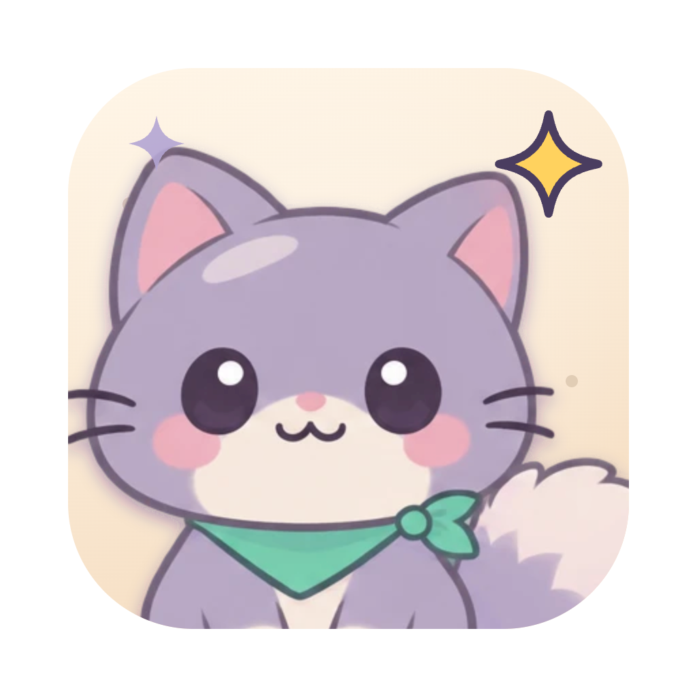

# Dusty design language

Dusty should feel like a friendly pet that tidies up, not a system utility. The cat is playful, the cleaning is
precise and the copy is honest about what gets deleted.

  
  &nbsp;&nbsp;
  
  &nbsp;&nbsp;
  

## Principles

1. **The cleaning is the hero.** Every screen answers *how much*, *what* and *is it safe*. Dusty adds warmth, not noise.
2. **Safe by default, loud about the rest.** Safe picks are preselected. Anything that costs a re-download is off and
   marked *opt-in*. Destructive actions always get a confirm step.
3. **One color per kind of mess.** A group keeps the same color everywhere: app rows, website cards, the disk bar.
4. **Chunky and tactile.** Buttons have a solid bottom edge and press down. The app adds haptics on Force Touch trackpads.

## Color

App (light, `app/src/ui.rs`):

| Token | Hex | Use |
|---|---|---|
| `BG` | `#FFFBF5` | window background, warm paper |
| `INK` | `#2B2340` | text |
| `MUTED` | `#8A84A3` | secondary text |
| `LINE` | `#E8E4F3` | card borders, button edges on light |
| `CARD` | `#FFFFFF` | cards and speech bubbles |

Tones, each with `base / edge / soft`:

| Tone | Base | Edge | Soft | Group |
|---|---|---|---|---|
| Grape | `#7C5CFF` | `#5B3FD9` | `#EFEAFF` | brand, primary action, re-downloadable |
| Coral | `#FF5A6E` | `#D63D52` | `#FFE5E9` | build folders, destructive confirm |
| Sun | `#FFC83D` | `#E0A100` | `#FFF4D6` | dev caches |
| Sky | `#3DB8FF` | `#1E93D6` | `#E3F5FF` | app caches |
| Teal | `#2EC4B6` | `#1E9C90` | `#DDF7F4` | junk and logs |
| Blue | `#5B8DEF` | `#3F6FD1` | `#E6EEFF` | Docker |
| Mint | `#22C993` | `#169E72` | `#DFF8EE` | success, space freed |

### Dark mode

The app follows the macOS appearance (`window.appearance()`), and switches live when System Settings changes it.
`DUSTY_APPEARANCE=dark|light` pins it, which is handy for screenshots. Both palettes live in `ui/theme.rs` (`LIGHT`, `DARK`):

| Token | Light | Dark |
|---|---|---|
| `bg` | `#FFFBF5` | `#17112B` |
| `card` | `#FFFFFF` | `#251C44` |
| `line` | `#E8E4F3` | `#3A2F63` |
| `ink` | `#2B2340` | `#F7F2FF` |
| `muted` | `#8A84A3` | `#B6ACD9` |

At night the tone bases stay vivid. Each tone gets a `text` color, lifted toward white so sizes and group names stay
readable on plum cards (coral `#FF8897`, sun `#FFD773`, mint `#60D8B1`…). `soft` becomes the base at about 22% over
the card, and button edges get darker so the chunky press still reads.

The website (`site/`) follows the visitor's system appearance, like the app: the light palette by day, and by night
the same plum tokens as the app (`#17112B` background, `#251C44` cards, lifted tone text such as mint `#60D8B1`). App
screenshots stay light, so at night they read like windows glowing in the dark. It tells one story as you scroll:
"The Red Bar". A nearly full
storage bar is the villain. Dusty starts worried under it, sniffs, finds 77.9 GB, refuses a `src/` chip, then eats
the safe segments one block at a time until 18.2 GB are free. His poses come from `site/img/moods/`, which holds the
sheet's five expressions plus the front, three-quarter and back views cut out as transparent PNGs.

## Type

- **Display:** system rounded (`ui-rounded`, SF Pro Rounded) at weight 900. Headlines, big numbers like *66.2 GB*,
  button labels in uppercase.
- **Body:** system UI at 400–600.
- **Code and paths:** system monospace.

No web fonts. The app uses `.SystemUIFont` with `FontWeight::BLACK` for display.

## Dusty

- Source art is `app/assets/dusty-sheet.png`: a lavender cat with a mint bandana and a fluffy cream tail, in front,
  three-quarter and back views plus five expressions (idle, happy, sad, surprised, sleepy).
- In the app the sheet is cut into a rig and animated live (`app/src/dusty/`). Moods follow the task: *think* while
  scanning, *wow* at a big find, *hungry* before cleaning, a chomp per item, *happy* when done, *sad* when an item
  can't be cleaned or the disk is nearly full.
- Dusty speaks in short bubbles, first person, lowercase energy: "Feeling a bit… heavy today.", "Om nom nom.",
  "Checking with git so I never touch your real code." Jokes never hide facts: sizes and paths are always exact.

## App icon

Dusty peeks up from the bottom edge of a purple squircle, with a sun-yellow sparkle (clean!) and a few dust specks.
The art is Dusty's real front pose (`assets/brand/dusty-front.png`, cut from the character sheet), so the icon and
the app always match. It follows the macOS grid: an 824 px squircle on a 1024 px canvas.

| Purple (default) | Mint | Cream |
|---|---|---|
|  |  |  |

People can switch colors in the app (**Dusty → App Icon**). This changes the Dock icon while Dusty runs and is saved
in user defaults. The Finder icon stays purple, because changing a signed bundle's icon would break its signature.

`assets/brand/dusty-icon.svg` is the master. After editing it, run `scripts/make-icons.sh` to re-render every color,
the 512 px PNGs embedded in the app, and `app/assets/Dusty.icns`.

## Icons

The app's icons are our own set (`app/assets/icons/ui/*.svg`, 48×48), chunky and flat like Dusty's buttons.
Never use emojis in the UI: they render differently on every macOS version and clash with the set.

- **Chunk**: every solid part sits on an underlay in the tone's edge color, a 3 px outline all around plus the same
  underlay shifted 3 px down (the bottom lip). Then the flat fill on top.
- **Highlight**: one white pill (about 55% opacity) at the top left; light always comes from the top left.
- **Color**: one tone (base + edge, from the palette) and at most one accent tone. Inner details are 3 px strokes in
  the edge color, or marks in the soft tint or white.
- **Sizes**: in a soft tone tile the icon fills about 64% of it (`icon_tile`); next to text it's 16–20 px, centered on
  the line (`icon_label`); sheet headers are 52 px and empty states 56 px. Tappable ones keep a 28 px hit target.
- **Rendering**: `ui/icons.rs` embeds the files and draws them with `img()` (full color), never `svg()` (a one-color
  mask). Each icon is rasterized at the size it's drawn (`icons/ui/<px>/<name>.svg`), so it stays sharp on Retina.

`scripts/ui-icons/gen.py` is the source. Edit it, then run `scripts/ui-icons/make.sh` to rewrite the SVGs and an
HTML contact sheet; add a new icon to the `icon_set!` list in `ui/icons.rs`.

## Motion

- Springs over easing curves. Things pop, hop and settle.
- The splash is under a second (badge pop, dust sweep, iris onto Dusty) and a click skips it.
- Dusty runs at 60 fps while moving, 30 while breathing and 12 when the window isn't focused.
- In the app, timings and spacing are named tokens in `ui/theme.rs` (`motion::*`, `sp::*`, `radius::*`, `ts::*`):
  things that arrive spring in (`back_out`), bars and counters fill with an ease-out, exits are faster than entrances.
  Sizes count up and use tabular digits so they never jiggle.
- With macOS **Reduce motion** on, the app skips the splash, confetti and slides; fades stay.
- On the web, scrolling scrubs the story: blocks arc into Dusty's mouth, he squashes on each chomp, and confetti
  fires once at the end. Under `prefers-reduced-motion` the page shows the finished state without motion.

## Voice

| Do | Don't |
|---|---|
| "Nothing is deleted until you say so." | "Optimize your system!" |
| "Slack is open, so its cache was left alone." | "Some items could not be processed." |
| "Re-downloadable: off until you tick it." | "Advanced cleaning" |
