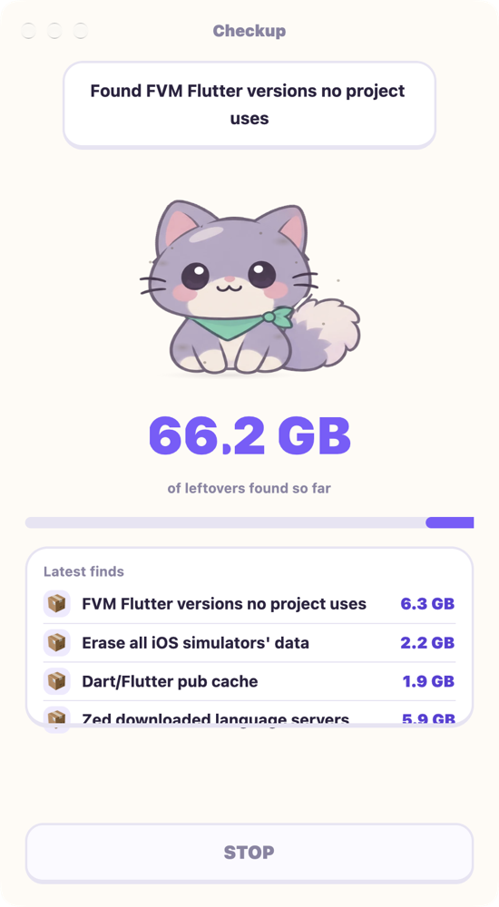

<div align="center">


# Dusty

**Your Mac is full of crumbs. Dusty eats them.**

A small macOS app that sniffs out build folders, dev caches and app junk,<br>
then clears them without touching anything you'd have to download again.

[](https://github.com/Deuspheara/dusty/actions/workflows/ci.yml)
[](https://github.com/Deuspheara/dusty/releases)
[](LICENSE)


[**Download**](https://github.com/Deuspheara/dusty/releases) ·
[**Website**](https://deuspheara.github.io/dusty/) ·
[What it cleans](#what-dusty-cleans) ·
[Safety](#house-rules) ·
[CLI](#the-cli)

<br>

<table>
  <tr>
    <td></td>
    <td></td>
    <td></td>
  </tr>
  <tr>
    <td align="center"><b>Sniff</b><br><sub>a one-tap disk checkup</sub></td>
    <td align="center"><b>Find</b><br><sub>leftovers add up live</sub></td>
    <td align="center"><b>Munch</b><br><sub>safe picks already selected</sub></td>
  </tr>
</table>

</div>

## Install

1. Grab `Dusty-x.y.z.dmg` from the [releases](https://github.com/Deuspheara/dusty/releases).
2. Drag **Dusty** to Applications and open it. Releases are signed and notarized by Apple, so it just opens.

Runs on Apple silicon and Intel, macOS 13 Ventura or later.

**Updates** come by themselves: Dusty checks once a day and shows what's new before anything is installed
(**Dusty → Check for Updates…** to look right away). Every update is verified twice: Apple's notarization and an
EdDSA signature that only Dusty's release pipeline holds the key to. Betas ship as GitHub pre-releases; a beta
keeps following betas, and **Dusty → Get Beta Updates** switches any copy over.

## What Dusty cleans

| | Kind | Picked by default | Examples |
|---|---|---|---|
| 🧱 | **Build folders** | yes | Flutter `build/` `.dart_tool/`, Gradle `build/` `.gradle/` `.cxx/`, SwiftPM `.build/`, Rust / Maven / sbt `target/`, CMake, Zig, .NET `bin/` `obj/`, Elixir `_build/`, Haskell `.stack-work/` `dist-newstyle/`, Elm, Godot, `.next` `.nuxt` `.svelte-kit` `.astro` `.turbo` `.nx` `dist` `coverage`, `__pycache__` and Python tool caches |
| 🗄️ | **Dev caches** | yes | Xcode DerivedData, DeviceSupport and caches, unavailable simulators, Gradle transforms, Dart analysis cache, Go / Zig / ESLint / Vite / Ruff caches, emulator snapshots, old Android Studio / JetBrains data, Homebrew. Current JetBrains indexes are opt-in (a reindex is slow) |
| 🌐 | **App caches** | yes | Browser, chat, media, VS Code / Cursor / Windsurf caches (skipped while the app is open) |
| 🧾 | **Junk & logs** | yes | Logs and crash reports, npm logs, old iPhone device logs, unfinished downloads, old Mail attachment copies. Xcode archives older than 6 months are opt-in (they hold the dSYMs for those builds' crash logs) |
| 🐳 | **Docker** | build cache, stopped containers | Images and volumes are opt-in |
| 📦 | **Re-downloadable** | no | `node_modules`, `.venv`, Pods, tox / nox / Pixi envs, Elixir `deps`, Composer `vendor`, Terraform providers, Gradle `modules-2`, npm / pnpm / Yarn / Bun / Deno / pip / uv / Poetry / Maven / Cargo / Go / Composer / NuGet caches, SwiftPM / CocoaPods / Carthage caches, Playwright / Puppeteer browsers, old simulator runtimes, old NDKs, unused FVM Flutter versions, pinned Rust toolchains |

Projects are looked for in `~/Documents`, `~/Developer`, `~/Projects` and the worktree folders that coding agents
use (`~/.codex/worktrees`, `~/.claude/worktrees`, `~/conductor/workspaces`…).

## More tools

Under **Start checkup** on the home screen:

- 🧺 **Uninstall apps**: your apps biggest first (type to search), and the files each one leaves in `~/Library`.
  Matching is strict, anything that may hold real data starts unticked, and Apple's apps and open apps are left alone.
- 🐘 **Big & old files**: large or long-unopened files in Downloads, Desktop, Movies and Documents. Nothing is ticked.
- 🗺️ **What's using space**: a map of your home folder, biggest blocks first. Tap a block to look inside. Read-only.
- 🕰️ **History**: every clean, uninstall and big-file trip, with **Put back** for whatever is still in the Trash.
- ⚙️ **Settings**: a weekly safe clean (Sundays 11:00), the menu bar item, practice runs and your ignore list.

When the app cleans, caches and build output are deleted, so the space comes back right away. Logs and anything
re-downloadable go to the Trash instead, and the summary says how much is waiting there.

## House rules

A cleaner you can't trust is worse than a full disk. Before anything is deleted:

- **Never your code.** A project folder is cleared only when its parent has a matching marker (`pubspec.yaml`,
  `build.gradle`, `Cargo.toml`…) **and**, inside a git repo, `git check-ignore` says it's ignored. A tracked `build/`
  folder holding real source is never touched.
- **Home only.** Paths must be absolute, inside your home folder, free of `..` and control characters. Symlinked
  ancestors are resolved so a link can't redirect a delete. Walks and deletes never follow symlinks and never cross
  into another volume (`rm -x`), even one mounted inside a project.
- **Hands off personal data.** Never a top-level folder (Documents, Library, Downloads…), Keychains, Mail, Contacts,
  Calendars, iCloud Drive, Dropbox / Google Drive / OneDrive folders (`~/Library/CloudStorage`), iPhone backups,
  Photos libraries or `.ssh`.
- **Not on this Mac, not touched.** iCloud placeholders (files kept only in the cloud) are never opened, which would
  download them, and never deleted, which would delete the cloud copy and free nothing.
- **Some caches aren't caches.** Offline music, password managers, cloud sync, VPNs, IDEs, virtualization and audio
  plugins keep real state in their cache folders, so they're skipped.
- **Downloads stay opt-in.** Package-manager and browser-runtime caches are never swept up as "app caches": each has
  its own item, off until you tick it.
- **Counted once.** Each folder belongs to one item, and a hard-linked file is counted once, so the total is what you
  actually get back.
- **Busy apps wait.** An app's cache is skipped while that app is running, and Dusty tells you to quit it first.
- **Nothing goes until you say so.** Every clean ends on a confirm screen, and *Practice run* shows the whole thing
  without deleting a byte.
- **Your ignore list wins.** List anything Dusty must never touch in `~/.config/dusty/ignore`. The app and the CLI
  both read it. If the file exists but can't be read, nothing is deleted.

```bash
# ~/.config/dusty/ignore
~/Documents/big-game/build      # this folder, what's inside it, and any folder that contains it
~/Developer/*/fixtures          # * matches one folder name, ** any number of folders
Secret Stuff                    # a bare name: any file or folder called that, anywhere
id:docker-images                # hide a whole item (ids are in `dusty scan --json`)
```

**Your own project types and folders** go in `~/.config/dusty/catalog.toml`, in the same format as the built-in
catalog ([`projects.toml`](app/crates/dusty-core/catalog/projects.toml), [`system.toml`](app/crates/dusty-core/catalog/system.toml)).
They come after the built-in ones, so they can only add: a folder a built-in item already covers stays with it, and a
user file can't run commands. If the file has a mistake, it's left out and Dusty says why.

```toml
# ~/.config/dusty/catalog.toml
[[rule]]                         # Unreal's Intermediate/ folder, next to a .uproject
dir = "Intermediate"
markers = ["*.uproject"]
kind = "Unreal intermediate"

[[target]]                       # a tool's cache in your home folder
id = "mytool-cache"
label = "MyTool cache"
group = "cache"
default_on = true
contents = [".mytool/cache"]
```

The safety approach was inspired by [Mole](https://github.com/tw93/Mole) and reimplemented from scratch in Rust; no
Mole code is included.

## The CLI

Same engine, same rules, in a terminal: a small Rust binary built on the app's engine (`app/crates/dusty-core`).

```bash
cargo install --path app/crates/dusty-cli   # installs the `dusty` command
dusty scan                 # report only
dusty                      # interactive: pick, confirm, delete
dusty --dry-run --yes      # what the default selection would remove
dusty --yes                # non-interactive, default selection (good for a cron)
dusty -k 3                 # keep artifacts of projects touched in the last 3 days
dusty -r ~/Code ~/Work     # scan these roots instead
dusty --trash              # move to the Trash instead of deleting
dusty history              # past cleans; `dusty put-back <id>` undoes a trashed one
dusty large                # review big / long-unused files (nothing preselected, picks go to the Trash)
dusty schedule on          # weekly safe clean (off | status)
dusty clean --json -n      # the plan as JSON, touching nothing (for scripts and agents)
dusty clean --json -y      # clean the default selection, print the plan and the report
```

## Build from source

```bash
cd app
./bundle.sh              # release build → app/target/Dusty.app
./bundle.sh universal    # Apple silicon + Intel
open target/Dusty.app
```

The app is Rust on [GPUI](https://gpui.rs). Dusty is a rigged character drawn on the GPU with Metal: springs, hops,
bendy ears, a wagging tail, blinks and chomps. See [app/README.md](app/README.md) for internals and debug switches,
and [DESIGN.md](DESIGN.md) for the visual language.

## Releasing

```bash
scripts/release.sh 0.2.0          # stable
scripts/release.sh 0.2.0-beta.1   # beta: a GitHub pre-release, offered only to beta users
```

That bumps the version in `app/Cargo.toml` (the app, the engine and the CLI share it), commits, tags and pushes. The
[Release workflow](.github/workflows/release.yml) then:

1. tests and builds a universal `Dusty.app` from scratch (no build cache), with [Sparkle](https://sparkle-project.org)
   embedded for updates;
2. signs it with the Developer ID and **fails if the signing team isn't the expected one**;
3. notarizes and staples the app and the DMG, and checks both with Gatekeeper;
4. signs the update zip with the Sparkle EdDSA key and publishes DMG, zip, checksums and
   [build provenance](https://docs.github.com/actions/security-for-github-actions/using-artifact-attestations)
   (`gh attestation verify Dusty-x.y.z.dmg -R Deuspheara/dusty`);
5. rebuilds the update feed at `deuspheara.github.io/dusty/appcast.xml` from every release.

It needs seven repository secrets (the Developer ID certificate, the notarization API key and the Sparkle key;
the list is at the top of the build job). A release stops at its first step if one is missing.

Every push and pull request runs the tests and builds, plus security checks: [gitleaks](https://github.com/gitleaks/gitleaks)
for secrets, `cargo audit` for vulnerable dependencies,
[zizmor](https://docs.zizmor.sh) for workflow security, dependency review on pull requests and CodeQL. Actions are
pinned to commit hashes and kept fresh by Dependabot. Run the same secret scan locally before you commit:

```bash
brew install gitleaks pre-commit && pre-commit install
```

## License

[MIT](LICENSE)
